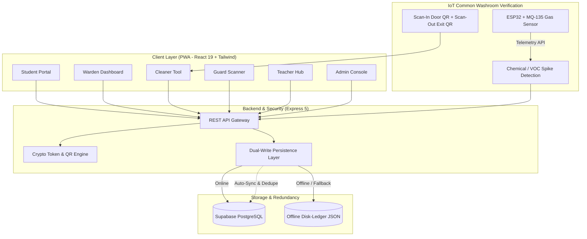

# 🏛️ CampusDebug OS

> **The Offline-First, Zero-Trust College Operations & IoT Sanitation Platform.**  
> Built with React 19, Express 5, Supabase (with resilient local disk-ledger fallback), and ESP32 IoT sensor telemetry.

[](https://nodejs.org/)
[](https://react.dev/)
[](https://expressjs.com/)
[](https://supabase.com/)
[](https://www.espressif.com/)
[](https://web.dev/progressive-web-apps/)
[](LICENSE)

---

## 📌 Executive Summary

Colleges and universities struggle with disconnected, paper-heavy operations:
1. **Cleaning Fraud & Ghosting:** Cleaners mark rooms and washrooms as "cleaned" on clipboards without doing the work.
2. **Campus Gate Security:** Paper gate passes and fake screenshot QRs bypass physical security.
3. **Flaky Campus Connectivity:** Standard cloud-only apps break the moment campus Wi-Fi or cellular networks drop.

**CampusDebug OS** is a unified, offline-first operating system designed to solve campus workflow friction with zero trust, real-time cryptographic validation, and sensor-grounded physical verification.

---

## 🌟 Key Innovations

### 1. 🔐 Zero-Trust Hostel Room Cleaning (Physical Presence Enforced)
* **Dynamic Rotating QRs:** Student room QRs rotate cryptographically with time-window validity (TweetNaCl/HMAC). Screenshots shared on WhatsApp expire within seconds.
* **No Fake Cleaning:** Cleaners cannot mark a room as cleaned on their dashboard without scanning the resident's live phone screen.
* **Auto-Exempt "All Away · Locked" Detection:** If all room occupants are away on approved gate passes or leave, the system automatically flags the room as locked and exempt from cleaning rounds.

### 2. 📡 IoT Sensor-Based Common Washroom Verification
* **Dual QR Setup:** 
  - **Scan-In QR (Outside Door):** Starts cleaning session.
  - **Scan-Out QR (Inside Near Exit):** Ends cleaning session.
* **Hardware-in-the-Loop Telemetry:** ESP32 microcontroller with an **MQ-135 air quality/gas sensor** continuously monitors chemical/VOC levels in the washroom.
* **Anti-Ghosting Verification Rules:**
  - ✅ **Time Gate:** Must spend at least 5 minutes inside the washroom (prevents quick in-and-out fake scans).
  - ✅ **Chemical Telemetry:** Sensor must detect a chemical/VOC spike caused by cleaning agents (phenyl, disinfectant, bleach).
  - ❌ **Ghosting Detection:** If dwell time is $<5\text{ mins}$ or no chemical spike is detected, the session is marked as **Failed (Ghosting)**.

### 3. ⚡ Offline-First Dual-Write Persistence
* **Resilient Architecture:** Writes to **Supabase (PostgreSQL)** when online and instantly falls back to an atomic **Local Disk-Ledger** during network dropouts.
* **Self-Healing Sync:** Automatically merges and deduplicates queued transactions when connectivity restores. Nothing is lost offline.

### 4. 👥 6 Role-Tailored Portals in a Single PWA
* 🎓 **Student Dashboard:** Dynamic gate pass requests, timetable, attendance tracking, fee dues, room QR generator, and instant complaint filing.
* 🛡️ **Guard Scanner:** High-speed scanner for campus gate entries, exit passes, cleaner staff badge check-in, and real-time parent SMS notifications.
* 🧹 **Cleaner Interface:** Distraction-free, single-screen camera tool for verifying hostel room cleans in real-time.
* 📋 **Warden Portal:** Hostel block oversight, floor-by-floor cleaning coverage heatmaps, gate pass approvals, and room inspection logs.
* 👨‍🏫 **Teacher Hub:** One-tap classroom attendance marking, timetable management, and peer substitution coverage.
* 🏛️ **Admin & Dean Console:** Campus-wide analytics, timetable scheduling engine, fee reconciliation, and formal audit exports.

---

## 🏗️ Architecture & Data Flow



---

## 🛠️ Tech Stack

* **Frontend:** React 19, Vite, Tailwind CSS, Lucide Icons, HTML5-QRCode
* **Backend:** Express 5 (Node.js ESM), WebPush, Axios, CORS
* **Database & Cloud:** Supabase (PostgreSQL), Atomic JSON disk-ledger
* **IoT & Hardware:** ESP32, MQ-135 Chemical / VOC Sensor
* **Cryptography & Auth:** TweetNaCl, rotating timestamp tokens, SHA-256 HMAC
* **Testing:** Node.js native test runner (`node:test`) with custom mock Supabase & fake-clock time-travel harness

---

## 🚀 Getting Started

### Prerequisites
* **Node.js** >= 20.0.0
* **npm** >= 10.0.0
* Supabase Account (Optional — full local ledger fallback included)

### 1. Clone & Install
```bash
git clone https://github.com/HaraPrasadGouda/CampusDebug-OS.git
cd CampusDebug-OS
npm install
```

### 2. Environment Configuration
Create a `.env` file in the root directory:
```env
PORT=3000

# Optional: Supabase Database (Auto-falls back to local ledger if omitted)
SUPABASE_URL=https://your-project.supabase.co
SUPABASE_KEY=your-supabase-anon-or-service-key
```

### 3. Run in Development Mode
```bash
# Terminal 1: Start Express API Backend
npm run server

# Terminal 2: Start Vite Frontend
npm run dev
```
Open [http://localhost:5173](http://localhost:5173) in your browser.

### 4. Build for Production
```bash
npm run build
npm run preview
```

---

## 🧪 Testing & Verification

The project includes an end-to-end automated test suite utilizing Node's native test runner (`node:test`). Tests run against an isolated local mock environment with injectable time-travel clocks:

```bash
# Run entire test suite
npm test
```

---

## 📊 Live User Roles & Credentials (Demo)

| Role | Username / Identifier | Password | Description |
| :--- | :--- | :--- | :--- |
| **Student** | `2101289001` | *Student Password* | Hostel resident with QR generation & pass access |
| **Cleaner** | `CLEANER-BH1-01` | `clean@BH1` | Dedicated hostel block cleaner |
| **Warden** | `warden_bh1` | *Warden Password* | Hostel warden with block approval rights |
| **Guard** | `guard_main` | *Guard Password* | Main gate barcode/QR pass scanning |
| **Teacher** | `prof_cse` | *Teacher Password* | Attendance & timetable management |
| **Admin** | `admin` | *Admin Password* | Central administration & audit oversight |

---

## 📄 License

This project is licensed under the MIT License — see the [LICENSE](LICENSE) file for details.
